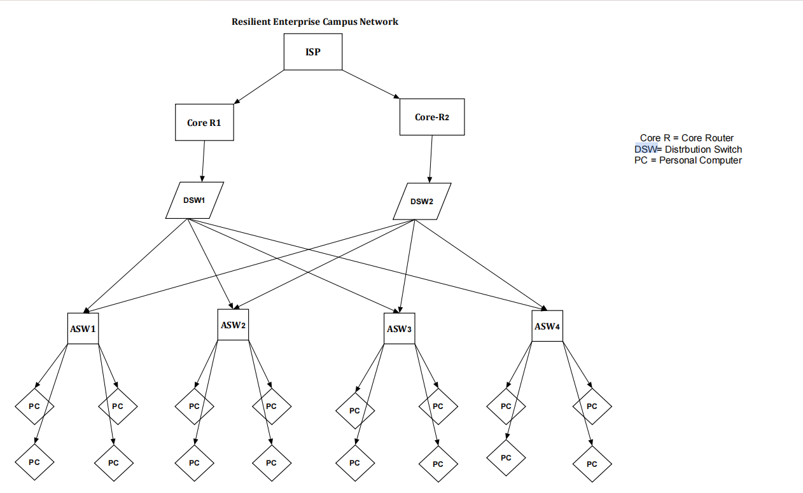

Project overview, architecture, feature list, topology preview, and test summary.

# Project Enterprise Campus Network with High Availability

## Overview

Project TITAN is an enterprise campus networking lab designed and implemented in Cisco Packet Tracer. It demonstrates hierarchical network design, resilient switching, dynamic routing, network segmentation, and fault-recovery validation.

## Objectives

- Design a scalable three-tier enterprise campus architecture.
- Implement VLAN segmentation and inter-VLAN routing.
- Configure STP and EtherChannel for Layer 2 resilience.
- Implement HSRP for redundant default gateways.
- Deploy OSPF across routed infrastructure links.
- Apply ACLs and secure network device management.
- Validate failover behavior through repeatable tests.
- Maintain complete technical documentation and configuration artifacts.

## Architecture

- Core/WAN routing layer
- Redundant Layer 3 distribution switches
- Layer 2 access switches
- Departmental VLANs
- Server and management networks
- Redundant uplinks and gateways

## Technologies

Cisco Packet Tracer, VLANs, 802.1Q, STP/RSTP, EtherChannel, inter-VLAN routing, HSRP, OSPF, ACLs, DHCP, DNS, SSH, and network troubleshooting.

## Repository Structure

- `docs/` — Architecture and design documentation
- `topology/` — Packet Tracer project and diagrams
- `configs/` — Device configurations
- `tests/` — Test procedures and results
- `evidence/` — Verification screenshots
- `CHANGELOG.md` — Project history

## Validation

The network is validated through connectivity tests, routing-table inspection, HSRP state verification, spanning-tree checks, security-policy tests, and controlled failure scenarios.

Detailed results and measured recovery behavior are documented in `tests/`.

## Scope and Limitations

This project is a simulation-based engineering lab. Feature support and behavior depend on the Packet Tracer version and device models. Results should not be interpreted as production hardware performance guarantees.

## Author

Feyisa Girma
