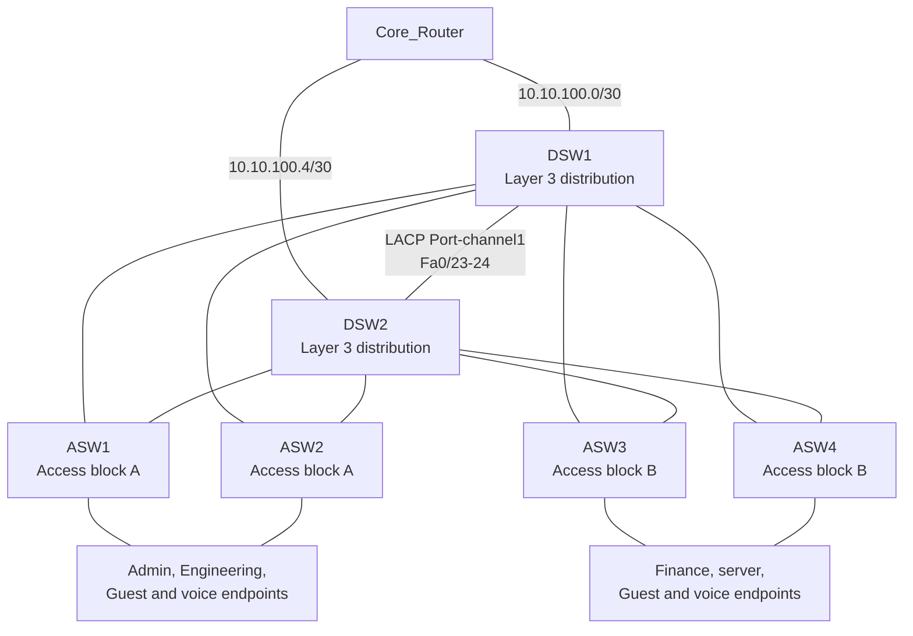

# Enterprise Campus Network Design and Implementation Document

## 1. Document Scope and Evidence

This document describes the intended campus network represented by the available Cisco-style configuration files, the topology image, and the repository README. Configuration details are transcribed from the files; they have not been independently confirmed against live device running configurations.

Evidence labels used below:

- **Configured** — explicitly present in a supplied configuration file.
- **Documented** — stated in the README or depicted in the available topology image.
- **Inferred** — a conservative interpretation of the supplied evidence; verify before implementation.
- **Unknown / not evidenced** — the repository does not supply enough information to assert a value or completed result.
- **Recommendation** — proposed work, not a description of the current configuration.

The requested `docs.text` file is not present. The available documentation consists of [`README.md`](../README.md), [`docs/documents.txt`](documents.txt), and [`topology/topology.png`](../topology/topology.png). `docs/documents.txt` lists documentation topics but contains no topology or configuration detail. The README links to `topology/image.png`, which is not present; the available image is `topology/topology.png`.

### 1.1 Sources

| Source | Evidence used |
|---|---|
| [`configs/Router/Core_Router.conf`](../configs/Router/Core_Router.conf) | Router hostname, routed interfaces, addresses, OSPF process |
| [`configs/Distrbution Switch/DSW1.cfg`](../configs/Distrbution%20Switch/DSW1.cfg) | VLANs, SVIs, HSRP, DHCP, trunks, EtherChannel, STP, OSPF |
| [`configs/Distrbution Switch/DSW2.cfg`](../configs/Distrbution%20Switch/DSW2.cfg) | VLANs, SVIs, HSRP, trunks, EtherChannel, STP, OSPF |
| [`configs/Access Switch/ASW1.cfg`](../configs/Access%20Switch/ASW1.cfg), [`ASW2.cfg`](../configs/Access%20Switch/ASW2.cfg) | Access port layout, uplink trunks, management IPs |
| [`configs/Access Switch/ASW3.cfg`](../configs/Access%20Switch/ASW3.cfg), [`ASW4.cfg`](../configs/Access%20Switch/ASW4.cfg) | Access port layout, uplink trunks, management IPs |
| [`topology/topology.png`](../topology/topology.png) | Depicted core, two distribution switches, four access switches, and endpoint groups |
| [`README.md`](../README.md) | Project goals and claimed technologies; not device-level proof of implementation or test results |
| [`tests/overview`](../tests/overview), [`evidence/overview`](../evidence/overview) | Descriptions of intended test/evidence contents only; no procedures, outputs, or screenshots are provided |

## 2. Architecture

### 2.1 Overview and objectives

**Documented:** The project is a Cisco Packet Tracer enterprise campus lab. Its stated objectives include a hierarchical network, VLAN segmentation, inter-VLAN routing, resilient switching, HSRP, OSPF, ACLs, secure management, and failover validation.

**Configured:** The supplied configs implement one core router, two multilayer distribution switches, and four Layer 2 access switches. They define VLANs, distribution SVIs, HSRP, Rapid PVST+, a distribution inter-switch LACP channel, routed core links, OSPF statements, DHCP pools on DSW1, and some access-edge protections.

**Important scope distinction:** ACLs, firewall rules, secure management, WAN services, DNS, and test results are not present in the supplied device configs or evidence. The README’s mention of these items is a project objective/technology list, not proof that they are configured or validated.

### 2.2 Physical and logical topology

The topology image depicts the core router above DSW1 and DSW2, with ASW1–ASW4 serving endpoint groups. Access-switch comments identify dual uplinks to both distribution switches. Configs describe a DSW1–DSW2 Port-channel1 using FastEthernet0/23–24 and core-facing routed GigabitEthernet0/1 links.



The diagram represents intended/configured relationships, not verified link state. Exact physical port mappings beyond those named in the configs and the image are **unknown**. In particular, access switch comments say Gi0/1 connects to DSW1 and Gi0/2 to DSW2; the corresponding distribution interfaces are described by access-switch name but their exact port mapping is not independently documented.

### 2.3 Device roles

| Device | Role and configured functions |
|---|---|
| Core_Router | Routed links to both distribution switches; OSPF process 10 |
| DSW1 | Multilayer distribution; VLAN SVIs, HSRP, DHCP scopes, Rapid PVST+, access/distribution trunks, LACP channel to DSW2, routed link to core, OSPF |
| DSW2 | Multilayer distribution; VLAN SVIs, HSRP, Rapid PVST+, access/distribution trunks, LACP channel to DSW1, routed link to core, OSPF configuration |
| ASW1–ASW2 | Layer 2 access switches for Admin, Engineering, voice-capable endpoint ports, and wired Guest ports |
| ASW3–ASW4 | Layer 2 access switches for Finance, server, voice-capable Finance endpoint ports, and wired Guest ports |

Device models, IOS releases, exact hardware capabilities, and the Packet Tracer version are **unknown**. Access-switch configs explicitly state that their port assumptions may need adjustment to match hardware.

### 2.4 Layer 2 and Layer 3 design

- **Layer 2:** Access ports are assigned to departmental VLANs. Access-to-distribution links are 802.1Q trunks with a configured native VLAN 999 and restricted allowed-VLAN lists. Rapid PVST+ is enabled on all switches represented in the configs. DSW1 and DSW2 configure LACP active mode on both members of Port-channel1.
- **Layer 3:** DSW1 and DSW2 enable `ip routing` and configure SVIs for VLANs 10, 20, 30, 40, 50, 60, and 99. HSRP version 2 provides virtual gateway addresses ending in `.1` for these VLANs. Routed /30 links connect the distribution switches to the core.
- **Inter-VLAN routing:** The distribution switches are configured to route between their directly connected SVIs. No ACLs restricting that routing are supplied; actual reachability also depends on operational state and any configuration outside this repository.
- **Resilience mechanisms configured:** Dual access uplinks are described, the distribution switches have a two-member LACP channel, STP priorities are split by VLAN, and HSRP priorities are split by VLAN. The configs express intended preference, not measured failover behavior.

### 2.5 Traffic flows and connectivity requirements

| Flow | Evidence-based design interpretation | Unspecified or unverified |
|---|---|---|
| Same VLAN endpoint traffic | Switched within its VLAN across access/distribution trunks as required | Endpoint addressing and successful forwarding |
| Endpoint to its VLAN gateway | HSRP virtual gateway `.1` is configured on the distribution SVIs; DHCP pools use the corresponding gateway for VLANs 10–60 | Operational HSRP states and client lease results |
| Inter-VLAN traffic | Routed by DSW1/DSW2 through the SVIs | Which VLANs are permitted to communicate; no ACL policy is supplied |
| Campus to core | Routed /30 links and OSPF are configured or attempted | Complete adjacencies, routes, default path, and external/WAN destination |
| Guest access | Guest VLAN 60 is assigned to wired access ports | Internet-only policy or isolation from internal networks is not configured/evidenced |
| Voice | VLAN 50 is configured and assigned as voice VLAN on selected access ranges | Call-control, DHCP option 150, QoS policy, and voice application destinations |

## 3. Requirements

This section separates supplied objectives from requirements that remain to be elicited. No performance targets or service-level objectives are provided.

### 3.1 Functional requirements

| Requirement | Status / evidence |
|---|---|
| Segment Admin, Finance, Engineering, Servers, Voice, Guest, and Management traffic | **Configured** as VLANs 10, 20, 30, 40, 50, 60, and 99 |
| Provide gateway addresses for routed VLANs | **Configured** using HSRP virtual addresses ending in `.1` |
| Provide DHCP for endpoint VLANs | **Partially configured** on DSW1 for VLANs 10–60; no pool for VLAN 99; DSW2 contains no DHCP pool |
| Provide campus routing | **Partially configured** with OSPF process 10; network statements and interface configuration need correction/verification |
| Provide redundant access/distribution connectivity | **Configured in intent** by dual uplink descriptions and distribution channel; live state not evidenced |
| Restrict inter-VLAN and Guest traffic | **Not configured/evidenced**; policy requirements must be defined |
| Provide DNS, WAN, and voice provisioning | **Unknown / not configured in supplied files** |

### 3.2 Non-functional requirements and open decisions

| Area | Evidence and remaining requirement |
|---|---|
| Availability | HSRP, STP, dual uplinks, and an EtherChannel are configured in intent. Availability target, maintenance window, and measured recovery time are not specified. |
| Scalability | Seven routed user/service VLANs and four access switches are represented. Growth targets, endpoint counts, address utilization, and expansion limits are unknown. |
| Performance | No bandwidth, latency, throughput, oversubscription, QoS, or application performance target is supplied. |
| Security | VLAN separation and selected access-port protections exist. Required trust boundaries, permitted flows, authentication, logging, and compliance needs are not supplied. |
| Infrastructure | Cisco Packet Tracer is documented. Device models, physical cabling, software versions, and production hardware requirements are unknown. |
| Operations | No configuration backup process, monitoring, NTP, syslog, AAA, or change-control procedure is evidenced. |

**Recommendation:** Confirm application, voice, DNS, Internet/WAN, availability, capacity, and security requirements with the network/application owners before treating this lab configuration as a deployable production design.

## 4. IP Addressing Plan

### 4.1 VLAN subnet allocations

All addresses below are IPv4 values explicitly present or directly derivable from configured `/24` subnets. The default gateway column reports the configured HSRP virtual address. No IPv6 configuration was found.

| VLAN | Name | Network / mask | Usable host range | Broadcast | HSRP gateway | DSW1 SVI | DSW2 SVI |
|---:|---|---|---|---|---|---|---|
| 10 | ADMIN | 10.10.10.0/24 (255.255.255.0) | 10.10.10.1–10.10.10.254 | 10.10.10.255 | 10.10.10.1 | 10.10.10.2 | 10.10.10.3 |
| 20 | FINANCE | 10.10.20.0/24 (255.255.255.0) | 10.10.20.1–10.10.20.254 | 10.10.20.255 | 10.10.20.1 | 10.10.20.2 | 10.10.20.3 |
| 30 | ENGINEERING | 10.10.30.0/24 (255.255.255.0) | 10.10.30.1–10.10.30.254 | 10.10.30.255 | 10.10.30.1 | 10.10.30.2 | 10.10.30.3 |
| 40 | SERVERS | 10.10.40.0/24 (255.255.255.0) | 10.10.40.1–10.10.40.254 | 10.10.40.255 | 10.10.40.1 | 10.10.40.2 | 10.10.40.3 |
| 50 | VOICE | 10.10.50.0/24 (255.255.255.0) | 10.10.50.1–10.10.50.254 | 10.10.50.255 | 10.10.50.1 | 10.10.50.2 | 10.10.50.3 |
| 60 | GUEST | 10.10.60.0/24 (255.255.255.0) | 10.10.60.1–10.10.60.254 | 10.10.60.255 | 10.10.60.1 | 10.10.60.2 | 10.10.60.3 |
| 99 | MANAGEMENT | 10.10.99.0/24 (255.255.255.0) | 10.10.99.1–10.10.99.254 | 10.10.99.255 | 10.10.99.1 | 10.10.99.2 | 10.10.99.3 |

The “usable host range” is the conventional subnet range and does not imply that every address is available for assignment. DSW1 excludes `.1`–`.99` from DHCP on VLANs 10–60; the first pool-eligible address is therefore `.100`. No DHCP scope is configured for VLAN 99.

### 4.2 Routed point-to-point links

| Link | Network / mask | Endpoint A | Endpoint B | Broadcast |
|---|---|---|---|---|
| Core_Router Gi0/0/0 – DSW1 Gi0/1 | 10.10.100.0/30 (255.255.255.252) | Core_Router: 10.10.100.2 | DSW1: 10.10.100.1 | 10.10.100.3 |
| Core_Router Gi0/0/1 – DSW2 Gi0/1 | 10.10.100.4/30 (255.255.255.252) | Core_Router: 10.10.100.6 | DSW2: 10.10.100.5 | 10.10.100.7 |

These are configured addresses; interface/link state has not been verified.

### 4.3 Management, static assignments, and DHCP

| Device/service | Addressing evidence |
|---|---|
| ASW1 management SVI | VLAN 99, 10.10.99.11/24; default gateway 10.10.99.1 |
| ASW2 management SVI | VLAN 99, 10.10.99.12/24; default gateway 10.10.99.1 |
| ASW3 management SVI | VLAN 99, 10.10.99.13/24; default gateway 10.10.99.1 |
| ASW4 management SVI | VLAN 99, 10.10.99.14/24; default gateway 10.10.99.1 |
| DSW management addresses | DSW1/DSW2 VLAN 99 physical SVI addresses 10.10.99.2 and 10.10.99.3; HSRP virtual gateway 10.10.99.1 |
| DHCP pools | DSW1 defines pools ADMIN, FINANCE, ENGINEERING, SERVERS, VOICE, and GUEST for VLANs 10–60. Each declares its `/24` network and `.1` default router. |
| DHCP exclusions | DSW1 excludes `.1` through `.99` in each VLAN 10–60 subnet. |
| DHCP DNS, domain, lease, reservation | Not configured in supplied pool definitions. |
| Voice DHCP option 150 | Not configured; DSW1 comment explicitly says the provisioning server is not known. |
| DSW2 DHCP | `service dhcp` is enabled, but no DHCP pools or exclusions are supplied. The DSW2 comment refers to split-scope DHCP, which is not implemented in the file. |

**Address allocation rationale:** Not documented. The repeating `/24` layout and `.1` gateway convention are observable, but no capacity calculations, reserved-address policy beyond DHCP exclusions, or allocation methodology are supplied.

## 5. VLAN Matrix

“Required communication” is not specified in the source materials. The matrix therefore lists observed assignment/carrying and flags policy decisions as unresolved rather than assuming allowed flows.

| VLAN ID | Name | Purpose / assigned devices | Subnet | Default gateway | Access ports | Trunks carrying VLAN | Inter-VLAN communication |
|---:|---|---|---|---|---|---|---|
| 10 | ADMIN | Admin endpoints on ASW1–ASW2 | 10.10.10.0/24 | 10.10.10.1 (HSRP) | ASW1/2 Fa0/1–8 | DSW1/2 to ASW1/2; DSW1–DSW2 Port-channel1 | No ACL policy supplied; permitted destinations must be defined |
| 20 | FINANCE | Finance endpoints on ASW3–ASW4 | 10.10.20.0/24 | 10.10.20.1 (HSRP) | ASW3/4 Fa0/1–8 | DSW1/2 to ASW3/4; DSW1–DSW2 Port-channel1 | No ACL policy supplied; permitted destinations must be defined |
| 30 | ENGINEERING | Engineering endpoints on ASW1–ASW2 | 10.10.30.0/24 | 10.10.30.1 (HSRP) | ASW1/2 Fa0/9–16 | DSW1/2 to ASW1/2; DSW1–DSW2 Port-channel1 | No ACL policy supplied; permitted destinations must be defined |
| 40 | SERVERS | Server endpoints on ASW3–ASW4 | 10.10.40.0/24 | 10.10.40.1 (HSRP) | ASW3/4 Fa0/9–16 | DSW1/2 to ASW3/4; DSW1–DSW2 Port-channel1 | No service-specific allowlist supplied; define client/server flows |
| 50 | VOICE | Voice VLAN; optional phones on ASW1–ASW3/4 endpoint ranges | 10.10.50.0/24 | 10.10.50.1 (HSRP) | Voice VLAN on ASW1/2 Fa0/1–16 and ASW3/4 Fa0/1–8 | All access uplinks; DSW1–DSW2 Port-channel1 | Call-control, provisioning, and QoS requirements unknown |
| 60 | GUEST | Wired Guest endpoints on all access switches | 10.10.60.0/24 | 10.10.60.1 (HSRP) | ASW1–ASW4 Fa0/17–20 | All access uplinks; DSW1–DSW2 Port-channel1 | Guest isolation/Internet-only policy is not configured |
| 99 | MANAGEMENT | Switch management SVIs; distribution switch management gateway | 10.10.99.0/24 | 10.10.99.1 (HSRP) | No user access ports assigned | All access uplinks; DSW1–DSW2 Port-channel1 | Management access restrictions are not configured |
| 999 | UNUSED-NATIVE | Configured native VLAN and unused access-port VLAN | No SVI/subnet configured | None configured | ASW1–ASW4 Fa0/21–24 (shutdown) | Configured as trunk native VLAN, but omitted from each trunk allowed-VLAN list | No Layer 3 routing; native-VLAN trunk behavior requires correction/validation |

ASW1–ASW4 configure voice VLAN 50 on the listed Admin/Engineering or Finance access ports where specified; they do not assign voice VLAN on server or wired Guest ports. DSW1 and DSW2 access-trunk allowed lists are consistent with their respective access-block VLANs, except that VLAN 999 is configured as native but omitted from the allowed lists.

## 6. Routing Design

### 6.1 Routing architecture and paths

The intended path is endpoint → access switch → distribution SVI/HSRP gateway → distribution/core routed link → core router. Inter-VLAN forwarding is configured at the distribution layer through `ip routing`. The OSPF process is numbered 10 and uses area 0 in the supplied statements.

No WAN-facing interface, external route, default route, route redistribution, or upstream next hop is configured in the provided files. Therefore, a path beyond the core router cannot be documented.

### 6.2 OSPF configuration summary

| Device | Configured OSPF details | Review |
|---|---|---|
| Core_Router | Process 10; `network 10.10.100.0 0.0.0.3 area 0` | Includes the DSW1 /30 link, but not the DSW2 link at 10.10.100.4/30 |
| DSW1 | Process 10; includes 10.10.100.0/30 and VLAN networks 10, 20, 30, 40, 50, and 99 in area 0 | Does not include VLAN 60. Verify whether OSPF should be enabled on each user-facing SVI; no passive-interface statements are present. |
| DSW2 | Process 10; includes 10.10.100.0/30 and VLAN networks 10, 20, 30, 40, 50, and 99 in area 0. An earlier Gi0/1 stanza also has `ip ospf 10 area 0`. | Network statement does not match DSW2’s 10.10.100.4/30 link. The duplicate Gi0/1 declaration and interface-level OSPF command make the effective intended configuration ambiguous; confirm on target IOS. VLAN 60 is omitted. |

There are no documented OSPF neighbors, router IDs, authentication settings, timers, passive-interface policy, route filters, or measured learned routes. Do not assume adjacencies are established.

### 6.3 HSRP and spanning-tree preference

| VLANs | HSRP preferred configured device | HSRP priorities (DSW1 / DSW2) | Configured STP preference |
|---|---|---:|---|
| 10, 30, 50, 99 | DSW1 | 110 / 100 | DSW1 priority 24576; DSW2 28672 |
| 20, 40, 60 | DSW2 | 100 / 110 | DSW2 priority 24576; DSW1 28672 |

Both distribution configs use HSRP version 2 and `preempt`. The configured priorities express an intended active-gateway/root split. Runtime HSRP state and STP root state are **not evidenced**. VLAN 999 has STP priorities configured (DSW1 24576, DSW2 28672), but no SVI.

### 6.4 Static routes, defaults, summarization, and redistribution

| Feature | Supplied configuration |
|---|---|
| Static routes | None found |
| Default route | None found |
| Redistribution | None found |
| Route summarization | None found |
| OSPF neighbors/areas beyond area 0 | Not documented |
| Expected campus routes | VLAN /24s may be advertised where OSPF is enabled and operational; VLAN 60 is omitted from both distribution network statements |

### 6.5 Routing and forwarding validation commands

These are **proposed** checks, not reported results:

```text
show ip interface brief
show ip route
show ip ospf neighbor
show ip ospf interface brief
show standby brief
show spanning-tree root
show etherchannel summary
```

## 7. Security Policies and Controls

### 7.1 Configured controls

| Control | Observed configuration | Limitation |
|---|---|---|
| VLAN segmentation | Separate departmental, server, voice, Guest, and management VLANs | No ACLs or firewall policy enforce isolation between routed VLANs |
| Access-edge protections | ASW1–ASW4 enable PortFast and BPDU Guard on active endpoint ranges; port security with sticky MAC is enabled on selected non-Guest ranges | Guest ports Fa0/17–20 have no port-security commands; no explicit maximum or violation action appears |
| Unused access ports | Fa0/21–24 assigned VLAN 999 and shut down on each access switch | Verify unused ports remain administratively down after deployment |
| Spanning tree | Rapid PVST+ configured; per-VLAN priorities set on DSW1/DSW2 | No root-guard, loop-guard, or storm-control configuration is supplied |
| Native VLAN | VLAN 999 selected as native on trunk interfaces | VLAN 999 is omitted from trunk allowed-VLAN lists; align native and allowed VLAN policy and validate behavior |
| Management network | VLAN 99 and static switch management IPs are configured | No SSH, AAA, access-class, or management-plane ACL configuration is supplied |

### 7.2 ACLs, firewall rules, and permitted flows

No ACL or firewall rules are present in the provided configuration files. No explicit allowed/denied flow matrix is documented. Since the distribution switches enable Layer 3 routing, VLAN membership alone does not establish routed isolation.

| Source / destination | Current policy evidence |
|---|---|
| Guest → internal VLANs | No deny rule supplied; isolation is not assured |
| Guest → Internet/WAN | No default route, WAN configuration, or allow policy supplied |
| User VLANs → Servers | No service-specific ACL or firewall policy supplied |
| User VLANs → Management VLAN | No management-plane restriction supplied |
| Voice → call-control/provisioning | No server, DNS, DHCP option 150, or ACL requirements supplied |
| Device management → switches | Management SVI and gateway exist; permitted administrator sources and secure protocol are unspecified |

### 7.3 Security gaps and recommended mitigations

The following are recommendations, not existing controls:

1. Define and implement a least-privilege inter-VLAN policy, especially Guest isolation, server access, and management-plane access.
2. Select a supported secure management protocol and configure authenticated access (for example, SSH with centralized AAA where available); restrict management sources to approved administrator hosts.
3. Decide and configure port-security limits and violation handling consistently, including whether Guest ports need equivalent endpoint controls.
4. Validate trunk allowed VLANs, native VLAN behavior, and unused-port shutdowns on every switch.
5. Define OSPF neighbor/authentication and passive-interface policy so routing adjacencies are limited to intended links.
6. Document HSRP security, device credential handling, logging, time synchronization, and configuration backup requirements.
7. Test security rules from both permitted and prohibited source/destination pairs before claiming segmentation.

## 8. Implementation and Configuration

### 8.1 Device-by-device summary

| Device/config | Summary | Dependencies / issues to resolve |
|---|---|---|
| Core_Router | Two routed /30 interfaces; OSPF process 10 includes only 10.10.100.0/30 | Add/confirm OSPF coverage for the DSW2 /30 if required; define default/WAN routing only when upstream requirements are known |
| DSW1 | VLAN database; `ip routing`; SVIs/HSRP; DHCP scopes; trunks; LACP Port-channel1; routed core link; OSPF; Rapid PVST+ | Earlier SVI stanzas assign `.1` as physical IP, followed by HSRP stanzas with physical `.2` and virtual `.1`; consolidate to avoid ambiguity. OSPF omits VLAN 60. Trunk allowed lists omit native VLAN 999. DHCP has no DNS/voice options and is not redundant in the supplied config. |
| DSW2 | VLAN database; `ip routing`; SVIs/HSRP; trunks; LACP Port-channel1; routed core link; OSPF; Rapid PVST+ | Gi0/1 is declared twice with the same IP but different descriptions; one stanza uses interface-level OSPF. Process network statement covers the DSW1 rather than DSW2 /30. OSPF omits VLAN 60. No DHCP pools are present despite a split-scope comment. Trunk allowed lists omit VLAN 999. |
| ASW1–ASW2 | Admin, Engineering, Guest, Voice, Management VLANs; access port assignments; dual trunk uplinks; static management IPs | Confirm physical models/port numbering, matching distribution port connections and trunk configuration |
| ASW3–ASW4 | Finance, Servers, Guest, Voice, Management VLANs; access port assignments; dual trunk uplinks; static management IPs | Confirm server addressing, physical models/port numbering, matching distribution port connections and trunk configuration |

### 8.2 Configuration dependencies

1. VLANs must exist on the relevant switches before access assignments and trunk carriage are validated.
2. Both ends of each trunk must agree on trunk mode, native VLAN, and allowed VLANs.
3. The distribution inter-switch channel requires matching physical member and Port-channel settings at both ends.
4. HSRP requires matching group/virtual IP settings and VLAN Layer 2 adjacency between distribution switches.
5. OSPF requires matching area and compatible interface/network activation on intended routed links.
6. DHCP clients require an operational SVI/gateway and a valid pool; current pools exist only on DSW1.
7. Secure/isolated connectivity cannot be validated until traffic policy and service destinations are defined.

### 8.3 Recommended deployment sequence

This is a proposed sequence; no deployment record is supplied.

1. Confirm hardware, IOS/Packet Tracer compatibility, physical port mapping, and approved requirements.
2. Back up current configs and resolve the duplicate SVI/interface declarations, OSPF omissions, DHCP redundancy decision, and VLAN 999 trunk policy.
3. Configure and verify VLANs, access ports, trunks, EtherChannel, and spanning-tree root placement.
4. Configure routed core links, distribution SVIs, HSRP, and OSPF; verify adjacencies and routes before moving endpoint traffic.
5. Configure and verify DHCP scopes/options, DNS, and any voice/server services once service requirements are confirmed.
6. Implement approved ACL/security and management-plane policy.
7. Connect or migrate endpoints in a controlled sequence; run the test plan in Section 9 and capture evidence.

### 8.4 Validation, rollback, and recovery

- **Before change:** Export device configs and record interface, VLAN, HSRP, STP, OSPF, DHCP, and routing state.
- **During change:** Apply one layer at a time; validate both ends of each link and keep console/out-of-band access available.
- **Rollback:** Restore the saved known-good configuration or reverse the specific change. The repository does not provide a tested rollback script or recovery timing.
- **After change:** Save verified configurations, archive command outputs, update the topology and address tables, and record deviations.

## 9. Test Report

No command outputs, test logs, or screenshots are present in the repository. The README describes validation at a high level, and the `tests/overview` and `evidence/overview` files describe intended contents; none of these provide case-level execution evidence. Accordingly, all tests below are **Not Tested**. Commands and expected results are proposed; no test is marked Passed.

| Test ID | Objective | Source → destination | Proposed procedure / command | Expected result | Actual result / evidence | Status | Remarks |
|---|---|---|---|---|---|---|---|
| T-01 | Device reachability | Admin test host → 10.10.10.1 | `ping 10.10.10.1`; inspect `show ip interface brief` on DSWs | Host reaches the active VLAN 10 gateway; required interfaces/SVIs are up | No execution output supplied | Not Tested | Verify VLAN/trunk state and HSRP before interpreting failure |
| T-02 | VLAN connectivity | Same-VLAN hosts on separate access switches | Assign known test hosts to the same VLAN; ping between hosts; inspect MAC/VLAN tables | Reachability within the same VLAN across intended trunks | No host addresses or results supplied | Not Tested | Repeat for each endpoint VLAN in scope |
| T-03 | Inter-VLAN routing | Admin host → approved Server VLAN host | Ping or application test after defining the approved flow; inspect `show ip route` | Only approved inter-VLAN traffic succeeds | No ACL policy or execution output supplied | Not Tested | Do not assume all inter-VLAN flows should be allowed |
| T-04 | OSPF adjacencies | Core_Router ↔ DSW1 and DSW2 | `show ip ospf neighbor`; inspect OSPF interfaces | Full adjacency on each intended routed link | No neighbor output supplied | Not Tested | Core process statement omits 10.10.100.4/30; DSW2 config needs review |
| T-05 | End-to-end campus path | Representative endpoint → approved remote/service destination | `tracert`/`traceroute` or application test; inspect route tables at each hop | Path follows endpoint gateway, distribution, and configured upstream route | No destination, routes, or results supplied | Not Tested | No WAN/default route is provided |
| T-06 | ACL enforcement / security isolation | Guest host → internal host and approved external service | Attempt explicitly defined allowed and denied flows; inspect ACL counters/logs | Denied flows fail and approved flows succeed | No ACLs, test cases, or evidence supplied | Not Tested | Cannot validate isolation until policy is implemented |
| T-07 | DHCP and DNS | Client in VLANs 10–60 → DHCP/DNS services | Renew lease; inspect client IP/gateway/DNS; inspect `show ip dhcp binding` | Correct subnet/gateway/options are delivered; DNS resolves approved names if configured | No lease/DNS output supplied | Not Tested | DNS options are absent; DSW2 has no pools; VLAN 99 has no pool |
| T-08 | HSRP gateway failover | VLAN endpoint → HSRP virtual gateway | `show standby brief`; fail/restore preferred distribution path/device under controlled conditions; monitor ping | Standby assumes virtual gateway and traffic recovers within an agreed target | No state or recovery measurement supplied | Not Tested | Recovery-time target is not specified |
| T-09 | STP / EtherChannel resilience | Access/distribution or DSW interconnect path | `show spanning-tree`; `show etherchannel summary`; controlled member/link failure | No persistent loop; channel/path remains usable or reconverges as designed | No state or failure evidence supplied | Not Tested | Confirm native/allowed VLAN configuration before test |
| T-10 | DHCP/service failover | DHCP client → configured DHCP service | Disable the active DHCP-serving path under controlled conditions and request/renew a lease | Lease service remains available if redundancy is a requirement | No test or DSW2 DHCP scope supplied | Not Tested | Current configs do not show split-scope implementation |

## 10. Findings and Recommendations

### 10.1 Findings

| Priority | Finding | Evidence / impact |
|---|---|---|
| High | OSPF configuration does not consistently cover both core links | Core_Router includes only 10.10.100.0/30; DSW2’s process statement also names that network even though its core interface is 10.10.100.5/30. DSW2 has an additional interface-level OSPF command, so intended behavior should be clarified and verified. |
| High | Guest and other inter-VLAN isolation is not established | No ACLs/firewall rules are supplied, while the distribution switches route between VLAN SVIs. Guest VLAN segmentation alone does not define routed access. |
| High | Distribution configs contain duplicate interface/SVI declarations | DSW1 initially assigns the HSRP gateway `.1` as the SVI address and later assigns `.2` with `.1` as HSRP virtual IP. DSW2 declares Gi0/1 twice. Consolidate and verify effective running configuration. |
| High | DHCP redundancy is described but not configured | DSW1 has DHCP pools for VLANs 10–60; DSW2 has no pools. No DHCP failover/split-scope configuration is supplied. |
| Medium | VLAN 60 is omitted from both distribution OSPF network statements | The Guest subnet is configured with an SVI and DHCP pool but is not included in the process network statements. Confirm if Guest should be advertised and how it should be controlled. |
| Medium | VLAN 999 is the configured native VLAN but is not in trunk allowed lists | Present on access, distribution-access, and distribution-interconnect trunk definitions. Confirm platform behavior and make native/allowed policy consistent. |
| Medium | DNS, voice provisioning, and service options are incomplete | DHCP pools do not configure DNS/domain options; voice option 150 is explicitly absent; no DNS or call-control server is specified. |
| Medium | Management plane is not secured in supplied configs | Management VLAN/IPs exist, but SSH, AAA, management access restrictions, and credential policy are not evidenced. |
| Low | Topology/documentation references do not align | Requested `docs.text` is absent, `docs/documents.txt` is only a topic list, and README points to the unavailable `topology/image.png` rather than the available `topology/topology.png`. |
| Low | Validation claims lack reproducible evidence | README describes validation, but repository test/evidence entries are overview text only; no test outputs, screenshots, or actual results are present. |

### 10.2 Prioritized recommendations

1. **Resolve high-priority routing and configuration ambiguity:** remove duplicate/contradictory declarations, define intended OSPF interfaces/networks on both core links, and verify neighbors/routes from device output.
2. **Specify and implement security policy:** define allowed/denied flows for Guest, user, server, voice, and management networks, then configure and test ACL/firewall enforcement.
3. **Decide DHCP resiliency and options:** implement a deliberate redundancy design if required; specify DNS, lease, reservation, and voice-provisioning values from authoritative service owners. Do not invent option values.
4. **Align trunk VLAN policy:** reconcile VLAN 999 native configuration with allowed VLAN lists on every trunk and validate end-to-end.
5. **Harden management and access edge:** define authenticated secure management, administrator source restrictions, port-security behavior, and operational logging.
6. **Create evidence-backed test records:** execute the tests in Section 9 in Packet Tracer or on target equipment, capture actual command/output evidence, and update statuses only from those results.
7. **Maintain source documentation:** update topology references, document exact device/port mappings and software versions, and keep the design, configs, and test report synchronized.

## 11. Assumptions and Unverified Items

- Device roles and endpoint groupings follow the names/comments in the configs and the topology image; exact physical placement and cable/port mappings are not fully evidenced.
- `/24` network, usable range, and broadcast values are mathematically derived from configured addresses/masks.
- HSRP virtual gateways are interpreted from `standby <group> ip` commands; operational ownership is not asserted.
- OSPF adjacencies, route installation, VLAN reachability, DHCP lease delivery, security enforcement, and failover are **unverified**.
- No IPv6, WAN, firewall, DNS, AAA, secure remote management, or production hardware/software details are included because the supplied files do not configure or specify them.
- All recommended policies, commands, and procedures in this document are proposals until approved and tested.
